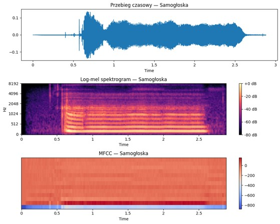
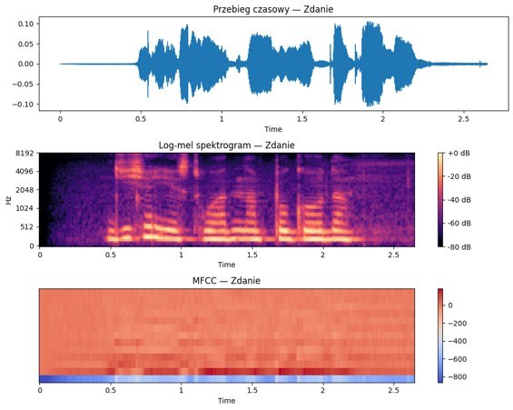
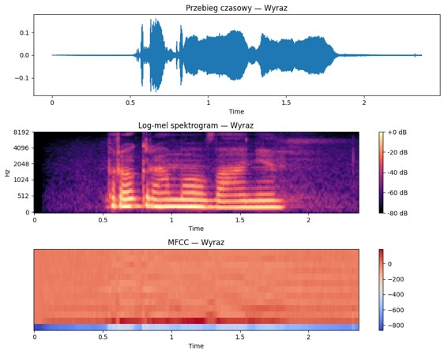

# Sprawozdanie z zajęć

**Przedmiot:** Uczenie głębokie w systemach rozpoznawania i przetwarzania mowy  
**Zajęcia nr / temat:** 1, Sekwencje i sygnał mowy: od fali dźwiękowej do reprezentacji  
**Autor / grupa:** Paulina Popławska gr. 3  
**Data:** 15.10.2026  

---

## 1. Cel i zakres ćwiczenia
Celem ćwiczenia jest cyfrowe przetwarzanie oraz analiza czasowo-częstotliwościowa sygnałów akustycznych mowy ludzkiej. Wykorzystując pakiet `librosa` w środowisku Python, dokonano ekstrakcji kluczowych reprezentacji cech, takich jak log-mel spektrogramy oraz współczynniki MFCC (*Mel-Frequency Cepstral Coefficients*) dla nagrań o różnej złożoności: pojedynczej samogłoski, wyrazu oraz pełnego zdania.

---

## 2. Parametry i konfiguracja
Analizę przeprowadzono dla stałej częstotliwości próbkowania $f_s = 16\ 000\text{ Hz}$ przy jednokanałowym trybie mono. Do celów porównawczych zdefiniowano trzy warianty rozdzielczości analizy STFT:

| Wariant parametru | Długość okna (`n_fft`) | Krok przesunięcia (`hop_length`) | Charakterystyka rozdzielczości |
| :--- | :---: | :---: | :--- |
| **Wysoka rozdzielczość czasowa** | $256$ próbek | $80$ próbek | Wysoka precyzja czasowa, słaba rozdzielczość częstotliwościowa. |
| **Standardowa** | $512$ próbek | $160$ próbek | Optymalny kompromis czasowo-częstotliwościowy. |
| **Wysoka rozdzielczość częstotliwościowa** | $2048$ próbek | $512$ próbek | Precyzyjna struktura harmoniczna (formanty), rozmycie w czasie. |

---

## 3. Kod
Poniższy kod źródłowy odpowiada za wczytanie plików `.m4a`, ekstrakcję spektrogramu w skali Mel oraz obliczenie 13 współczynników MFCC:

```python
import librosa
import librosa.display
import matplotlib.pyplot as plt
import numpy as np

# Przykład wczytania sygnału i ekstrakcji cech
file_path = 'audio.m4a'
sr = 16000

# 1. Wczytanie audio
y, sr = librosa.load(file_path, sr=sr, mono=True)

# 2. Obliczenie Log-Mel Spektrogramu
n_fft = 512
hop_length = 160
mel_spectrogram = librosa.feature.melspectrogram(y=y, sr=sr, n_fft=n_fft, hop_length=hop_length)
log_mel_spectrogram = librosa.power_to_db(mel_spectrogram, ref=np.max)

# 3. Obliczenie współczynników MFCC (13 cech)
mfccs = librosa.feature.mfcc(y=y, sr=sr, n_mfcc=13, n_fft=n_fft, hop_length=hop_length)
```

---

## 4. Wyniki

* **A. Samogłoska ("Aaaaa")**  
  

* **B. Wyraz ("Programowanie")**  
  

* **C. Zdanie ("Dzisiaj jest ładna pogoda")**  
  

🔗 **Link do notatnika Google Colab:** [Otwórz notatnik Colab](https://colab.research.google.com/drive/1IsbB0IZS1o20UmECqvawpQ_XcwFp0wlc?usp=sharing)

---

## 5. Analiza

* **Samogłoski:** Spektrogram samogłoski charakteryzuje się wyraźnie widocznymi, poziomymi prążkami odpowiadającymi formantom (częstotliwościom rezonansowym traktu głosowego). Reprezentacja MFCC zachowuje stabilne wartości w czasie trwania dźwięku.
* **Wyrazy i Zdania:** Analiza ciągu mowy wykazała obecność pauz (brak energii na spektrogramie) oraz wyraźnych przejść tonalnych pomiędzy głoskami dźwięcznymi i bezdźwięcznymi. Bezdźwięczne spółgłoski trące wykazują energię skupioną w wyższych pasmach częstotliwości (szum).
* **Wpływ parametru `n_fft`:** Dobór rozmiaru okna STFT wiąże się bezpośrednio z zasadą nieoznaczoności Gabora-Heisenberga. Małe okno (`n_fft=256`) pozwala precyzyjnie zlokalizować początek i koniec głosek, ale rozmywa pasma formantowe. Duże okno (`n_fft=2048`) pozwala na rozdzielenie poszczególnych harmonicznych głosu, lecz powoduje rozmycie czasowe zjawisk szybkich.
* **Skuteczność MFCC:** Współczynniki MFCC kompresują informację widmową, odzwierciedlając nieliniową percepcję słuchu ludzkiego (skala Mel), stanowiąc kluczowy wektor cech dla systemów automatycznego rozpoznawania mowy (ASR).

---

## 6. Wnioski
Biblioteka `librosa` jest bardzo przydatna w zadaniach analizy mowy. Optymalnym kompromisem do ogólnych zastosowań parametryzacji mowy przy częstotliwości próbkowania $16\text{ kHz}$ pozostaje okno o długości `n_fft=512` próbek z krokiem `hop_length=160`.